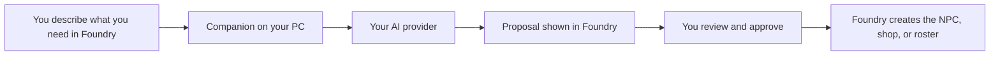

# Tablewright Assistant

An AI companion for Game Masters using Pathfinder Second Edition in Foundry VTT.

Describe what you need, review the assistant's proposal, and approve the result inside Foundry. For example:

> Find a goblin NPC and turn it into Rook, a suspicious sewer guide with a short background.

## What you can do today

- Import an existing NPC with a new name and background.
- Create a shopkeeper's merchant sheet stocked with items from installed compendiums.
- Propose an encounter using existing creatures and calculate its PF2e XP.
- Review each proposal before a GM approval click creates anything.

A compendium is Foundry's library of creatures or items. Version 0.1.1 uses those existing entries. Original generated statistics, token placement, and automatic combat setup are not available yet.

## Start here

**[Follow the beginner installation guide for Windows](docs/install.md).**

The guide explains what to download, where to paste each command, what to expect, and how to recover when a step fails. You do not need Git or GitHub CLI.

The source is public under the MIT license. This is an early alpha. The guide below uses GitHub's source ZIP. There is no tagged release package, automatic installer, or Foundry package-directory installation yet.

The first target is Foundry 14 with PF2e 8.5.1, running on the same Windows PC as the assistant. Use a disposable test world. Live Foundry rendering, real imports, and paid AI requests remain unverified. Hosted Foundry and HTTPS connections are not supported by this alpha.

## How the pieces connect

You install two parts. The Foundry module shows the assistant window. The companion runs on your PC and connects that window to your AI.

The beginner guide uses an OpenAI API key for the button inside Foundry. If you already use local Codex or Claude tools, the [advanced MCP instructions](docs/technical-reference.md#configure-a-local-mcp-client) describe that option.

## Cost and privacy

Tablewright has no module charge.

You need your own Foundry license and AI access. The in-window OpenAI option can incur API charges. [OpenAI bills API usage separately from a ChatGPT subscription](https://help.openai.com/en/articles/9039756-managing-billing-settings-on-the-chatgpt-web-and-api-platform). The MCP option uses your AI client's own access and limits.

Your provider key stays in the companion's local settings. Your prompt and limited world and compendium metadata go to the configured AI provider when you use the model button. Full source statistics, source artwork, and existing journal contents stay in Foundry. Read the [data-flow details](docs/technical-reference.md#understand-the-data-flow) before using private campaign material.

## Need help?

Start with [installation troubleshooting](docs/install.md#if-something-goes-wrong). [Open an issue](https://github.com/tom-l-mot/tablewright-assistant/issues/new/choose) to report a bug or suggest a feature. Use the [help request checklist](docs/install.md#ask-for-help) and never include your API key, pairing token, settings file, campaign names, or player information.

Report security vulnerabilities through the private reporting method in [SECURITY.md](SECURITY.md). Do not post them as public issues.

## For technical users and contributors

- [How to contribute](CONTRIBUTING.md).
- [Advanced setup and MCP configuration](docs/technical-reference.md).
- [Verification evidence and live checklist](docs/verification.md).
- [Architecture](docs/architecture.md).
- [Source credits and license notices](docs/provenance.md).

The source is public under the MIT license. A tagged release package, a Foundry listing, and the remaining live checks are still pending.

## Support development

If you'd like to support development, you can [buy me a coffee on Ko-fi](https://ko-fi.com/tomlmot). Thanks for your support!
