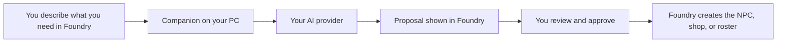

# Tablewright Assistant

An AI companion for Game Masters using Pathfinder Second Edition in Foundry VTT.

Describe what you need, review the assistant's proposal, and approve the result inside Foundry. For example:

> Find a goblin NPC and turn it into Rook, a suspicious sewer guide with a short background.

## What you can do today

- Import an existing NPC with a new name and background.
- Create a shopkeeper's merchant sheet stocked with items from installed compendiums.
- Propose an encounter using existing creatures and calculate its PF2e XP.
- Review each proposal before a GM approval click creates anything.

A compendium is Foundry's library of creatures or items. Version 0.1.1 uses those existing entries. Original generated statistics, token placement, and automatic combat setup are not available yet.

## Start here

**[Follow the beginner installation guide for Windows](docs/install.md).**

The guide explains what to download, where to paste each command, what to expect, and how to recover when a step fails. You do not need Git or GitHub CLI.

This is a development alpha. There is no release download, automatic installer, or Foundry package-directory installation yet.

The first target is Foundry 14 with PF2e 8.5.1, running on the same Windows PC as the assistant. Use a disposable test world. Live Foundry rendering, real imports, and paid AI requests remain unverified. Hosted Foundry and HTTPS connections are not supported by this alpha.

## How the pieces connect

You install two parts. The Foundry module shows the assistant window. The companion runs on your PC and connects that window to your AI.

The beginner guide uses **Continue with ChatGPT** inside Foundry. It does not require an API key. An OpenAI API key remains optional, and the [advanced MCP instructions](docs/technical-reference.md#configure-a-local-mcp-client) cover local Codex or Claude tools.

## Cost and privacy

Tablewright has no module charge. Optional donations are the intended funding approach, but a donation page has not been set up.

You need your own Foundry license and AI access. Eligible ChatGPT accounts can use their plan through [Sign in with ChatGPT](https://developers.openai.com/siwc/token-sharing-open-source), subject to shared plan limits and any credits the account holder enables. The optional API-key path uses separate [API billing](https://help.openai.com/en/articles/9039756-managing-billing-settings-on-the-chatgpt-web-and-api-platform). The MCP option uses your AI client's own access and limits.

ChatGPT credentials are protected locally by Windows for your user account. An optional API key stays in the companion's local settings. Your prompt and limited world and compendium metadata go to OpenAI when you send a model request. Full source statistics, source artwork, and existing journal contents stay in Foundry. Read the [data-flow details](docs/technical-reference.md#understand-the-data-flow) before using private campaign material.

## Need help?

Start with [installation troubleshooting](docs/install.md#if-something-goes-wrong). If you are still stuck, use the [help request checklist](docs/install.md#ask-for-help) to report the failing step. Never include credentials, pairing tokens, or settings files.

## For technical users and contributors

- [Advanced setup and MCP configuration](docs/technical-reference.md).
- [Verification evidence and live checklist](docs/verification.md).
- [Architecture](docs/architecture.md).
- [Source credits and license notices](docs/provenance.md).

The code uses the MIT license. A release download, a Foundry listing, and the remaining live checks are still pending.
